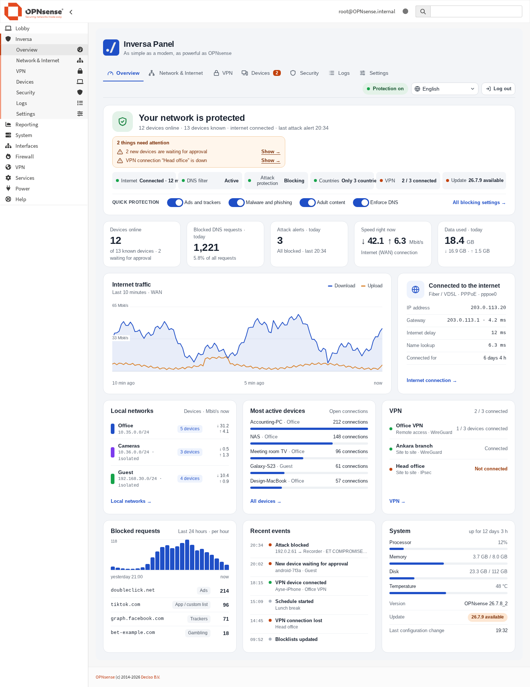
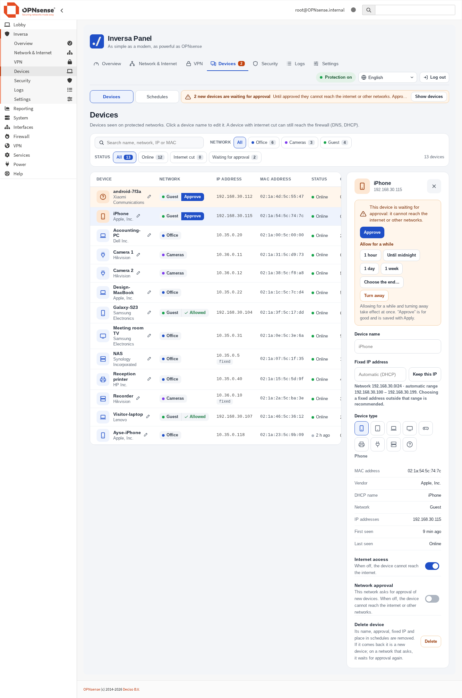
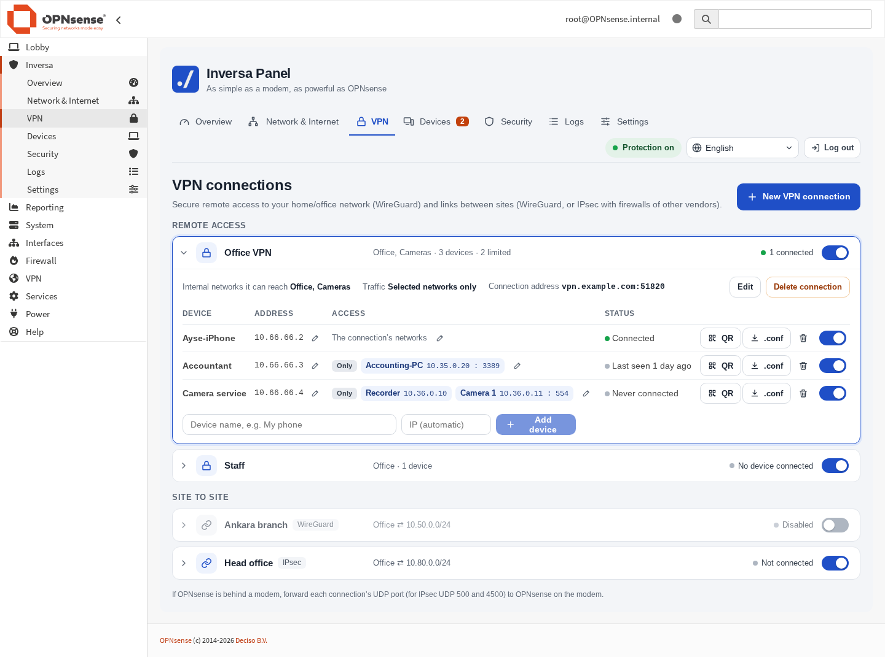
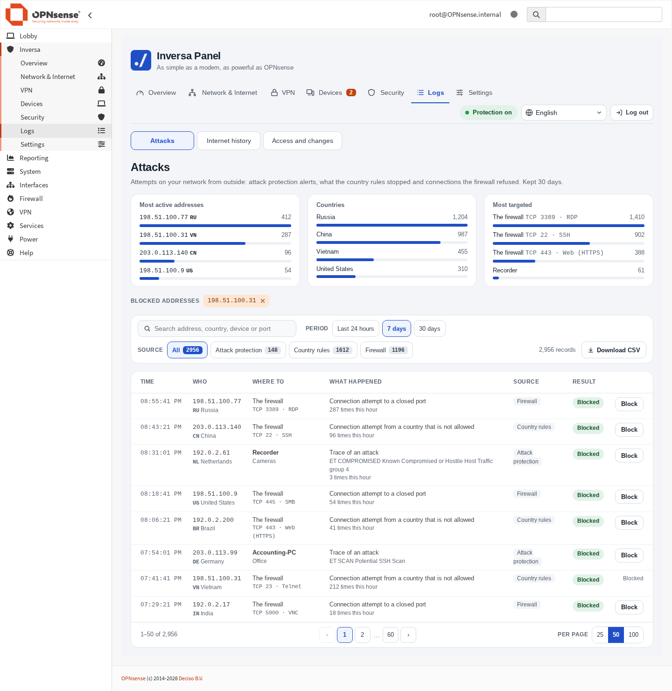
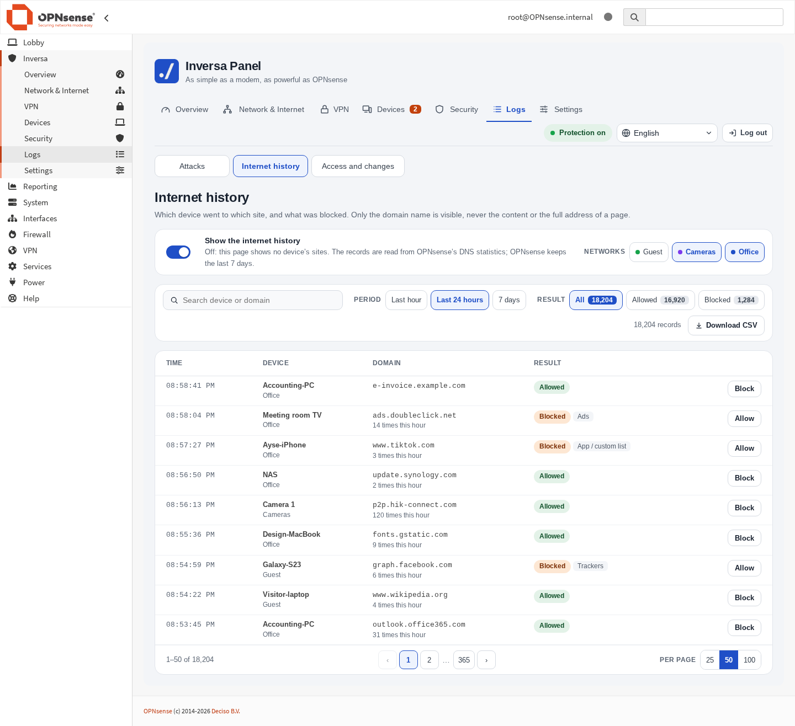
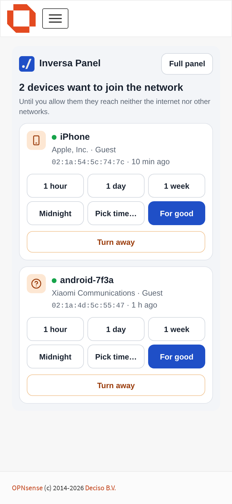

<p align="center">
  
</p>

<h1 align="center">Inversa Panel</h1>

<p align="center">
  <b>As simple as a modem, as powerful as OPNsense.</b><br>
  The most used OPNsense settings on one plain screen.<br>
  <b>English</b> · <a href="README.tr.md">Türkçe</a>
</p>

<p align="center">
  <a href="https://github.com/inversa-bilisim/os-inversa-panel/releases/latest"></a>
  <a href="https://github.com/inversa-bilisim/os-inversa-panel/actions/workflows/package.yml"></a>
  <a href="LICENSE"></a>
  
</p>



Inversa Panel is an open source plugin for [OPNsense](https://opnsense.org) 26.7. It puts devices, the internet filter, VPN, attack protection and logs on one screen, so everyday work on a home or small-office firewall does not need a tour of OPNsense's menus.

It is not a separate system beside OPNsense. It reads the configuration that is there and writes into OPNsense's own models (aliases, Unbound, WireGuard, IPsec, intrusion detection), so everything it sets up stays visible and editable in OPNsense's own pages.

Screenshots show sample data.

## What it does

**Overview.** Whether the network is protected and what needs attention, the state of every protection in one line, devices online, blocked DNS requests and attack alerts today, live speed and today's data usage, the internet connection, local networks, VPN connections, recent events and the system's health.

**Network & Internet**
- Internet connection: PPPoE, static address or behind a modem; VLAN tag, IPv6, MAC address, MTU; a connection test that runs by itself.
- Local networks: add a network on a VLAN or its own port, with DHCP, a colour, isolation from other networks, a speed limit and approval of new devices. An access table decides which network may start connections to which.
- DNS: local names for devices at home, and the servers the firewall asks (automatic, Cloudflare, Google, Quad9, AdGuard DNS or your own), optionally over TLS. Servers are tried before they are used.
- Port forwarding in one line, with suggestions for common services.

**VPN**
- Remote access with WireGuard: a QR code and `.conf` file per device, available again at any time.
- Per-device access: a device reaches what its connection reaches, or only the addresses and ports chosen for it. This is enforced on the firewall, so changing the file on the device does not get around it.
- Site to site with WireGuard, or with IPsec (IKEv2) for firewalls of other vendors, including a sheet of the values to enter on the other side.

**Devices**
- Every device seen on the protected networks, with its network, address and state; search and filters; names and types.
- Cut a device's internet access with one click, give it a fixed address, approve new devices on networks that ask for it — for good, for an hour, a day, a week or until a chosen time — or turn them away, delete devices.
- On a phone the panel opens on a short screen with only the devices waiting for approval: a Telegram message says one is waiting, you connect over the VPN, log in and decide in one tap.
- Schedules: cut internet access or block apps for chosen devices at chosen times.
- Pause a device for 30 minutes, an hour, two hours or until the morning; it comes back by itself. Wake a device that is off (Wake-on-LAN).

**Security**
- Categories (ads and trackers, malware and phishing, adult content, gambling, VPN and proxy), twelve apps, safe search, and "Enforce DNS" for devices that try to use another DNS server.
- Allow and block lists for domains.
- Countries: block chosen countries, or let only chosen countries in. Uses the free DB-IP Lite data, no account needed.
- Attack protection with Suricata: alert only, or block.

**Logs**
- Attacks: attack alerts, what the country rules stopped and connections the firewall refused, with the source's country and a button to block an address. Kept 30 days.
- Internet history: which device asked for which domain and what was blocked. Off unless switched on, per network.
- Access and changes: VPN connections, logins to the web interface, new devices, who changed the configuration. Kept 90 days.

**Backup and updates**
- Download the configuration, put it back from a file, and a copy taken every night (the last 7 are kept on the firewall).
- One page for updates of the panel and of OPNsense: what is new, which packages change, whether a restart follows; the update with its log, and the page waits for the firewall to come back.

**Notifications**
- A Telegram bot tells you when a new device joins the network or waits for approval, when attack protection raises an alert, when a VPN device connects, when the internet connection was down and when somebody fails to log in. The firewall only sends; it takes no commands from Telegram.

| | |
|---|---|
|  |  |
|  |  |

### New devices, from your phone

On a network that asks for approval, a new device gets no further than the firewall until you let it in. Telegram tells you within seconds that a device is waiting. You connect to the firewall over the VPN and log in; on a phone the panel opens on a short screen with only the waiting devices. One tap lets a device in for an hour, a day, a week, until midnight, until a time you pick or for good, or turns it away. When the time is up the device waits again and you are told again.

Switch on **Settings › Open Inversa Panel after logging in** so that the phone lands on this screen right after the login.

<p align="center"></p>

## How it treats your firewall

- **Nothing is switched on unasked.** On first start a setup wizard asks for the networks to protect, the protections, approval of new devices and notifications; nothing reaches the firewall before its last step, and until then the panel only reads. The wizard can be closed and run again from Settings.
- **It touches only what you change in it.** Existing firewall rules stay in force; the access table adds a rule only where you set a cell to allowed or blocked.
- **What it cannot understand it shows read-only**: multi-WAN, networks on LAGG or bridge members, port forwards that use aliases, DNS forwarding or intrusion detection that was set up in OPNsense itself.
- **Risky changes put themselves back.** Network changes, tightening "only these countries" and changing DNS servers take a backup first. If you do not confirm within 90 seconds, OPNsense restores the earlier configuration.
- **Everything it adds is labelled** "Inversa Panel". *Settings › Remove what Inversa Panel added* deletes exactly those entries. Its automatic firewall rules are never written to `config.xml` and disappear with the plugin.

## Requirements

- OPNsense 26.7 (developed on 26.7.8).
- A user with full administrator rights for changes.
- For WireGuard and IPsec, OPNsense's own components; the panel uses whatever is installed.

### Memory

**With DNS blocking or attack protection, plan for 8 GB of RAM. 4 GB is not enough.** Without them the plugin needs no memory worth mentioning.

The memory goes to OPNsense's own services, and how much depends on what is switched on. Measured on the test firewall:

| What | Memory |
|---|---|
| Unbound with "Ads and trackers", "Malware and phishing" and "Gambling" (about 2.2 million domains) | 1.6 GB |
| Refreshing the blocklists, for the time it takes | about 1 GB more |
| Suricata with the four default rule groups (about 41,000 rules), Hyperscan matcher | 450 MB |
| The same with OPNsense's default matcher | 3.5 GB |

The panel picks Hyperscan when the processor supports it (SSSE3), checks free memory before it starts Suricata and says so when there is too little, and never runs a blocklist refresh and a Suricata start at the same time. On a 4 GB test machine without swap, a refresh that coincided with a restart of Unbound exhausted memory: once Unbound stopped, once the firewall hung.

## Installation

On the firewall, as root (SSH, or the console's shell):

```sh
pkg add https://github.com/inversa-bilisim/os-inversa-panel/releases/latest/download/os-inversa-panel.pkg
```

Then open **Inversa** in OPNsense's menu, or `https://<firewall address>/ui/inversapanel`. Nothing changes on the firewall until you switch something on in the panel.

**We recommend a fresh OPNsense installation.** The panel can be installed on a firewall that is already configured and leaves the existing settings alone, and works with part of them as they are (networks, fixed addresses, simple port forwards, local names); firewall rules, NAT, VPN connections and services set up in OPNsense keep working beside the panel and are still managed on OPNsense's own pages. *Settings › Existing settings* lists what the panel found, what stays in OPNsense and what can get in the way of a feature (another DHCP server, blocklists, intrusion detection that already runs, manual outbound NAT). The panel was developed and tested on fresh installations; if you install it on a working firewall, download a configuration backup first (*System › Configuration › Backups*).

- **Update:** Settings › Updates › **Check for an update** (from 1.3.0 on; up to 1.5.0 it was on Settings › About) (asks GitHub only when pressed; backs up first and checks the settings afterwards). Or run the same command again. Settings and records are kept.
- **Remove:** `pkg delete os-inversa-panel`. This removes the panel, its firewall rules and its records (data usage, events, logs). What it wrote into the OPNsense configuration (aliases, the blocklist policy, VPN connections, networks) stays; run *Settings › Remove what Inversa Panel added* before removing the package if you want those gone as well.

The package is built for OPNsense 26.7. All releases and their files are on the [releases page](https://github.com/inversa-bilisim/os-inversa-panel/releases); changes are listed in the [changelog](CHANGELOG.md).

For development, `tools/deploy.sh root@<firewall address>` copies the files from a checkout onto a test firewall without a package, and `tools/build-pkg.sh` builds the package on FreeBSD or on an OPNsense box.

## Languages

Turkish, English, German, French, Spanish and Italian. "Automatic" follows OPNsense's system language. German, French, Spanish and Italian are machine translations that no native speaker has reviewed yet; corrections are welcome. Adding a language is one file, see the [reference](docs/reference.md#adding-a-language).

## Status

Version 1.6.0. Developed and tested on a virtual OPNsense 26.7.8. Not yet tested on real hardware or lines:

- PPPoE (the test environment has no PPPoE server).
- A WireGuard connection from a real phone or laptop; the generated configuration and the firewall rules were checked.
- IPsec with other vendors' firewalls; it was tested between two OPNsense installations.
- Blocking mode of attack protection on VLANs and physical network cards.
- UPnP.

The complete list of limits, and what each page writes where, is in the [reference](docs/reference.md).

## Documentation

- [Reference](docs/reference.md): pages and where they write, folder layout, API, test steps, known limits.
- [Başvuru belgesi (Türkçe)](docs/reference.tr.md)

## Feedback

Bugs and requests: [GitHub issues](https://github.com/inversa-bilisim/os-inversa-panel/issues). Want to help? See [CONTRIBUTING.md](CONTRIBUTING.md). Contact: yazilim@inversa.com.tr · [inversa.com.tr](https://inversa.com.tr)

## Licence

BSD 2-Clause, see [LICENSE](LICENSE). © 2026 Inversa Bilişim.

Inversa Panel builds on OPNsense, Unbound, Suricata, WireGuard and strongSwan. Country data: [IP Geolocation by DB-IP](https://db-ip.com) (CC BY 4.0).
