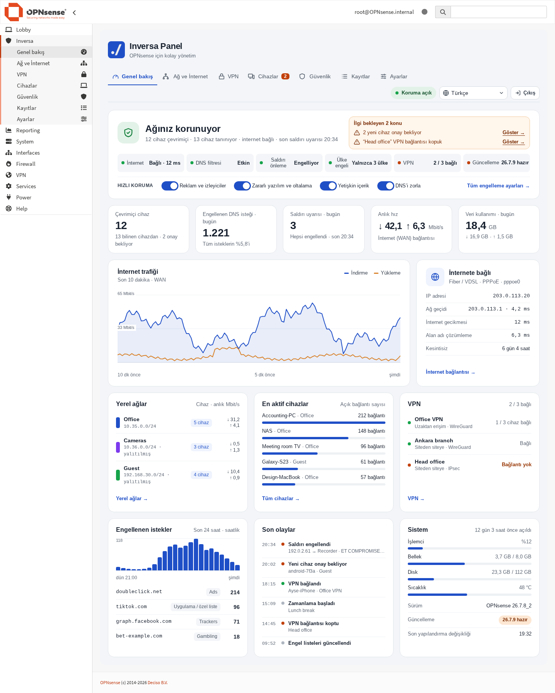
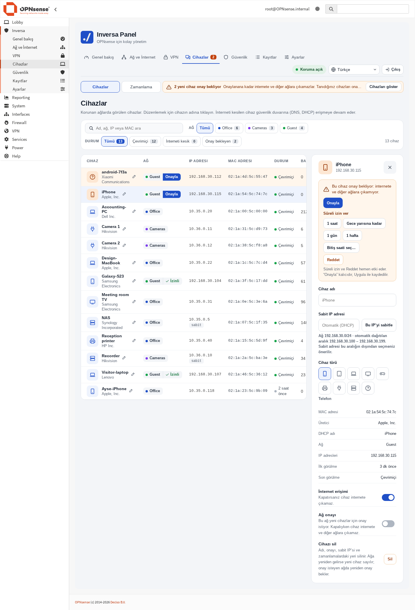
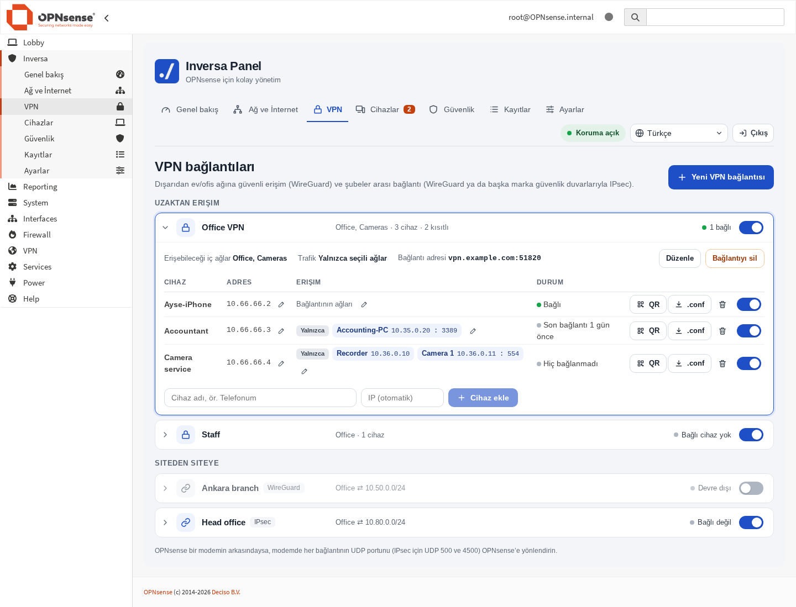
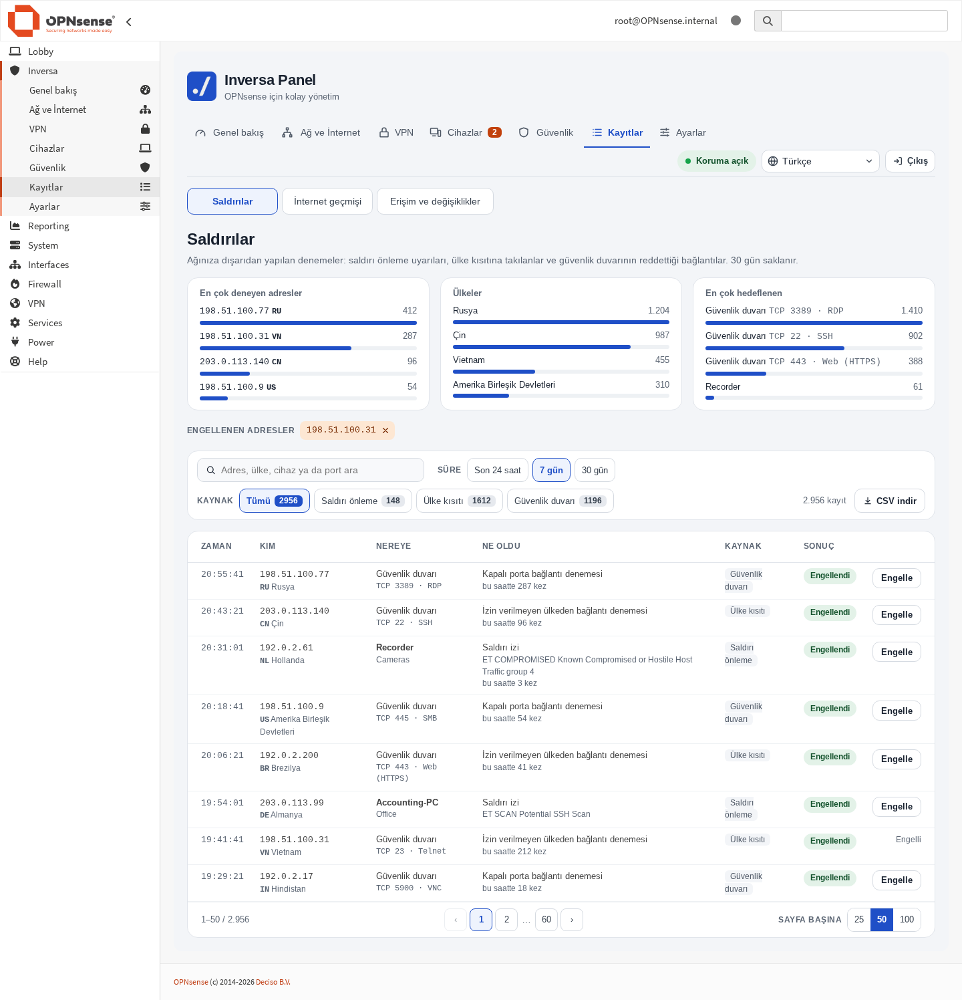
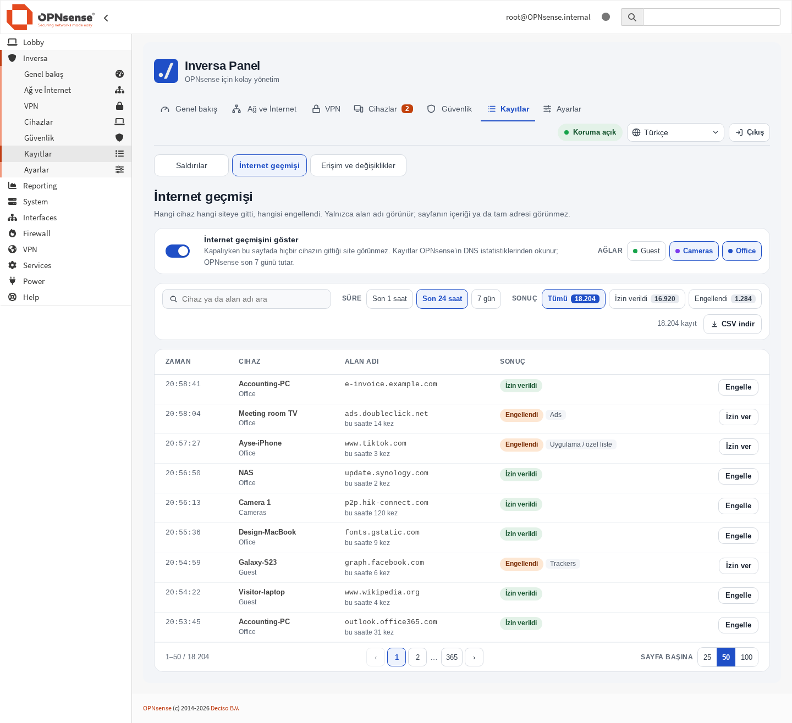
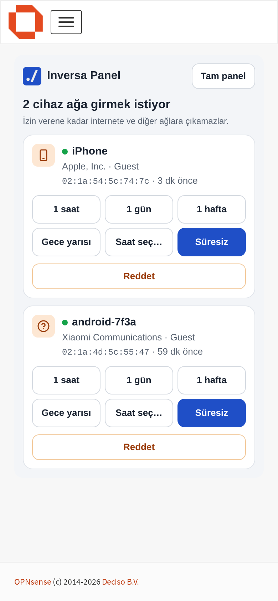

<p align="center">
  
</p>

<h1 align="center">Inversa Panel</h1>

<p align="center">
  OPNsense’in en çok kullanılan ayarları tek, sade bir ekranda.<br>
  <a href="README.md">English</a> · <b>Türkçe</b>
</p>

<p align="center">
  <a href="https://github.com/inversa-bilisim/os-inversa-panel/releases/latest"></a>
  <a href="https://github.com/inversa-bilisim/os-inversa-panel/actions/workflows/package.yml"></a>
  <a href="LICENSE"></a>
  
</p>



Inversa Panel, [OPNsense](https://opnsense.org) 26.7 için açık kaynaklı bir eklentidir. Cihazları, internet filtresini, VPN'i, saldırı önlemeyi ve kayıtları tek ekranda toplar; ev ya da küçük ofis güvenlik duvarında günlük işler için OPNsense menülerinde dolaşmak gerekmez.

OPNsense'in yanında ayrı bir sistem değildir. Mevcut yapılandırmayı okur ve OPNsense'in kendi modellerine yazar (takma adlar, Unbound, WireGuard, IPsec, saldırı tespiti); kurduğu her şey OPNsense'in kendi sayfalarında görünür ve oradan da düzenlenebilir.

Ekran görüntülerindeki veriler örnektir.

## Neler yapar

**Genel bakış.** Ağın korunup korunmadığı ve ilgi bekleyen konular, her korumanın tek satırlık durumu, çevrimiçi cihazlar, bugün engellenen DNS istekleri ve saldırı uyarıları, anlık hız ve bugünkü veri kullanımı, internet bağlantısı, yerel ağlar, VPN bağlantıları, son olaylar ve sistem durumu.

**Ağ ve İnternet**
- İnternet bağlantısı: PPPoE, sabit IP ya da modem arkasında; VLAN etiketi, IPv6, MAC adresi, MTU; kendiliğinden çalışan bağlantı testi.
- Yerel ağlar: VLAN üzerinde ya da ayrı portta ağ ekleme; DHCP, renk, diğer ağlardan izolasyon, hız sınırı ve yeni cihaz onayı. Hangi ağın hangisine bağlantı başlatabileceğini erişim tablosu belirler.
- DNS: iç ağdaki cihazlar için yerel adlar ve güvenlik duvarının soracağı sunucular (otomatik, Cloudflare, Google, Quad9, AdGuard DNS ya da kendi adresleriniz), isteğe bağlı şifreli (DNS over TLS). Sunucular kullanılmadan önce denenir.
- Port yönlendirme: tek satırda, yaygın servisler için önerilerle.

**VPN**
- WireGuard ile uzaktan erişim: cihaz başına QR kodu ve `.conf` dosyası, istendiği zaman yeniden alınabilir.
- Cihaz başına erişim: cihaz bağlantının ulaştığı her yere ya da yalnızca kendisine tanımlanan adres ve portlara ulaşır. Kısıtlama güvenlik duvarında uygulanır; cihazdaki dosyayı değiştirmek onu aşmaz.
- Siteden siteye: WireGuard ile, ya da başka marka güvenlik duvarları için IPsec (IKEv2) ile; karşı tarafa girilecek değerlerin listesiyle birlikte.

**Cihazlar**
- Korunan ağlarda görülen bütün cihazlar; ağı, adresi ve durumuyla. Arama ve filtreler, ad ve tür verme.
- Tek tıkla bir cihazın internetini kesme, sabit IP verme, onay isteyen ağlarda yeni cihazları süresiz ya da bir saatliğine, bir günlüğüne, bir haftalığına veya seçilen saate kadar onaylama, reddetme, cihaz silme.
- Telefonda panel yalnızca onay bekleyen cihazları gösteren kısa bir ekranla açılır: Telegram'dan bir cihazın beklediği haberi gelir, VPN ile bağlanıp giriş yaparsınız ve tek dokunuşla karar verirsiniz.
- Zamanlama: seçilen cihazlar için seçilen saatlerde interneti kesme ya da uygulama engelleme.
- Bir cihazı 30 dakika, bir saat, iki saat ya da sabaha kadar durdurma; süre bitince kendiliğinden açılır. Kapalı bir cihazı uzaktan uyandırma (Wake-on-LAN).

**Güvenlik**
- Kategoriler (reklam ve izleyiciler, zararlı yazılım ve oltalama, yetişkin içerik, kumar, VPN ve proxy), on iki uygulama, güvenli arama ve başka DNS sunucusu kullanmaya çalışan cihazlar için "DNS'i zorla".
- Alan adları için beyaz ve kara liste.
- Ülkeler: seçilen ülkeleri engelleme ya da yalnızca seçilen ülkelere izin verme. Ücretsiz DB-IP Lite verisini kullanır, hesap gerekmez.
- Suricata ile saldırı önleme: yalnızca uyar ya da engelle.

**Kayıtlar**
- Saldırılar: saldırı uyarıları, ülke kısıtına takılanlar ve güvenlik duvarının reddettiği bağlantılar; kaynağın ülkesi ve adresi engelleme düğmesiyle. 30 gün saklanır.
- İnternet geçmişi: hangi cihaz hangi alan adını sordu, hangisi engellendi. Açılmadıkça kapalıdır; ağ bazında seçilir.
- Erişim ve değişiklikler: VPN bağlantıları, panele girişler, yeni cihazlar, yapılandırmayı kimin değiştirdiği. 90 gün saklanır.

**Yedek**
- Yapılandırmayı indirme, dosyadan geri yükleme ve her gece alınan kopya (son 7 kopya güvenlik duvarında saklanır).

**Bildirimler**
- Bir Telegram botu; ağa yeni bir cihaz girdiğinde ya da onay beklediğinde, saldırı önleme uyarı verdiğinde, bir VPN cihazı bağlandığında, internet bağlantısı koptuğunda ve hatalı giriş denemesinde haber verir. Güvenlik duvarı yalnızca gönderir; Telegram'dan komut almaz.

| | |
|---|---|
|  |  |
|  |  |

### Yeni cihazlar, telefondan

Onay isteyen bir ağda yeni cihaz, siz izin verene kadar güvenlik duvarından öteye geçemez. Bir cihazın beklediğini Telegram birkaç saniye içinde haber verir. VPN ile güvenlik duvarına bağlanıp giriş yaparsınız; telefonda panel yalnızca bekleyen cihazları gösteren kısa bir ekranla açılır. Tek dokunuşla cihaza bir saatliğine, bir günlüğüne, bir haftalığına, gece yarısına, seçtiğiniz saate kadar ya da süresiz izin verirsiniz veya reddedersiniz. Süre dolunca cihaz yeniden onay bekler ve yeniden haber gelir.

Telefonun girişten hemen sonra bu ekrana düşmesi için **Ayarlar › Girişten sonra Inversa Panel açılsın** ayarını açın.

<p align="center"></p>

## Güvenlik duvarınıza nasıl davranır

- **Sorulmadan hiçbir şey açılmaz.** İlk açılışta panel önerilen korumaları teklif eder; kabul edene kadar yalnızca okur.
- **Yalnızca panelden değiştirdiğinize dokunur.** Mevcut güvenlik duvarı kuralları geçerli kalır; erişim tablosu yalnızca bir hücreyi izinli ya da engelli yaptığınızda kural ekler.
- **Anlayamadığını salt okunur gösterir**: çoklu WAN, LAGG ya da köprü üyesi ağlar, takma ad kullanan port yönlendirmeleri, OPNsense'te kurulmuş DNS yönlendirme ya da saldırı tespiti.
- **Riskli değişiklikler kendini geri alır.** Ağ değişiklikleri, "yalnızca bu ülkeler" kısıtının sıkılaşması ve DNS sunucusu değişikliği önce yedek alır. 90 saniye içinde onaylamazsanız OPNsense önceki yapılandırmayı geri yükler.
- **Eklediği her kayıt** "Inversa Panel" etiketi taşır. *Ayarlar › Inversa Panel'in eklediklerini kaldır* yalnızca bu kayıtları siler. Otomatik güvenlik duvarı kuralları `config.xml`'e hiç yazılmaz; eklenti kaldırılınca kendiliğinden kaybolur.

## Gereksinimler

- OPNsense 26.7 (26.7.8 üzerinde geliştirildi).
- Değişiklik yapmak için tam yönetici yetkili bir kullanıcı.
- WireGuard ve IPsec için OPNsense'in kendi bileşenleri; panel kurulu olanı kullanır.

### Bellek

**DNS engelleme ya da saldırı önleme kullanılacaksa 8 GB RAM planlayın. 4 GB yetmez.** Bunlar kapalıyken eklentinin kayda değer bir bellek ihtiyacı yoktur.

Belleği OPNsense'in kendi servisleri kullanır; ne kadar kullanacağı neyin açık olduğuna bağlıdır. Test güvenlik duvarında ölçülen:

| Ne | Bellek |
|---|---|
| Unbound; "Reklam ve izleyiciler", "Zararlı yazılım ve oltalama" ve "Kumar ve bahis" açıkken (yaklaşık 2,2 milyon alan adı) | 1,6 GB |
| Engel listeleri yenilenirken, yenileme süresince | yaklaşık 1 GB daha |
| Suricata; dört varsayılan kural grubu (yaklaşık 41 bin kural), Hyperscan eşleyici | 450 MB |
| Aynısı, OPNsense'in varsayılan eşleyicisiyle | 3,5 GB |

Panel, işlemci destekliyorsa (SSSE3) Hyperscan'i kendisi seçer, Suricata'yı başlatmadan önce boş belleğe bakar ve yetmiyorsa bunu söyler, engel listesi yenilemesi ile Suricata başlatmayı aynı anda çalıştırmaz. Takas alanı olmayan 4 GB'lık bir test makinesinde, Unbound'un yeniden başlamasıyla çakışan bir yenileme belleği tüketti: bir seferinde Unbound durdu, bir seferinde güvenlik duvarı kilitlendi.

## Kurulum

Güvenlik duvarında, root olarak (SSH ya da konsol kabuğu):

```sh
pkg add https://github.com/inversa-bilisim/os-inversa-panel/releases/latest/download/os-inversa-panel.pkg
```

Ardından OPNsense menüsünde **Inversa**'yı ya da `https://<güvenlik duvarı adresi>/ui/inversapanel` adresini açın. Panelde bir şeyi açana kadar güvenlik duvarında hiçbir şey değişmez.

**Yeni kurulmuş bir OPNsense öneririz.** Panel, yapılandırılmış bir güvenlik duvarına da kurulabilir ve mevcut ayarlara dokunmaz; bir kısmını olduğu gibi kullanır (ağlar, sabit adresler, basit port yönlendirmeleri, yerel adlar); OPNsense'te yapılmış güvenlik duvarı kuralları, NAT, VPN bağlantıları ve servisler panelin yanında çalışmaya devam eder ve yine OPNsense'in kendi sayfalarından yönetilir. *Ayarlar › Mevcut ayarlar* sayfası panelin ne bulduğunu, neyin OPNsense'te kaldığını ve neyin bir özelliği etkileyebileceğini (başka bir DHCP sunucusu, engel listeleri, zaten çalışan saldırı tespiti, elle giden NAT) listeler. Panel yeni kurulumlarda geliştirildi ve denendi; çalışan bir güvenlik duvarına kuracaksanız önce yapılandırma yedeği indirin (*Sistem › Yapılandırma › Yedekler*).

- **Güncelleme:** 1.3.0'dan itibaren Ayarlar › Hakkımızda › **Güncellemeyi denetle** (GitHub'a yalnızca basılınca bakar; önce yedek alır, sonra ayarları denetler). Ya da aynı komutu yeniden çalıştırın. Ayarlar ve kayıtlar korunur.
- **Kaldırma:** `pkg delete os-inversa-panel`. Paneli, güvenlik duvarı kurallarını ve kayıtlarını (veri kullanımı, olaylar, günlükler) kaldırır. OPNsense yapılandırmasına yazdıkları (takma adlar, engelleme listesi ilkesi, VPN bağlantıları, ağlar) kalır; onların da gitmesini istiyorsanız paketi kaldırmadan önce *Ayarlar › Inversa Panel'in eklediklerini kaldır*'ı çalıştırın.

Paket OPNsense 26.7 için derlenir. Bütün sürümler ve dosyaları [sürümler sayfasında](https://github.com/inversa-bilisim/os-inversa-panel/releases), değişiklikler [değişiklik günlüğünde](CHANGELOG.md) yer alır.

Geliştirme için `tools/deploy.sh root@<güvenlik duvarı adresi>` dosyaları paket olmadan bir test güvenlik duvarına kopyalar; `tools/build-pkg.sh` paketi FreeBSD'de ya da bir OPNsense kutusunda derler.

## Diller

Türkçe, İngilizce, Almanca, Fransızca, İspanyolca ve İtalyanca. "Otomatik", OPNsense'in sistem dilini izler. Almanca, Fransızca, İspanyolca ve İtalyanca makine çevirisidir ve henüz ana dili bu olan biri tarafından gözden geçirilmedi; düzeltmelere açığız. Yeni dil eklemek tek dosyadır, bkz. [başvuru belgesi](docs/reference.tr.md#yeni-dil-eklemek).

## Durum

Sürüm 1.0.0. Sanal bir OPNsense 26.7.8 üzerinde geliştirildi ve denendi. Gerçek donanım ya da hat üzerinde henüz denenmeyenler:

- PPPoE (test ortamında PPPoE sunucusu yok).
- Gerçek bir telefon ya da bilgisayardan WireGuard bağlantısı; üretilen yapılandırma ve güvenlik duvarı kuralları doğrulandı.
- Başka marka güvenlik duvarlarıyla IPsec; iki OPNsense kurulumu arasında denendi.
- Saldırı önlemenin engelleme modu, VLAN'larda ve fiziksel ağ kartlarında.
- UPnP.

Sınırların tam listesi ve her sayfanın nereye ne yazdığı [başvuru belgesinde](docs/reference.tr.md).

## Belgeler

- [Başvuru belgesi](docs/reference.tr.md): sayfalar ve yazdıkları yer, klasör yapısı, API, test adımları, bilinen sınırlar.
- [Reference (English)](docs/reference.md)

## Geri bildirim

Hata ve istekler: [GitHub issues](https://github.com/inversa-bilisim/os-inversa-panel/issues). Katkıda bulunmak için: [CONTRIBUTING.md](CONTRIBUTING.md) (İngilizce). İletişim: yazilim@inversa.com.tr · [inversa.com.tr](https://inversa.com.tr)

## Lisans

BSD 2-Clause, bkz. [LICENSE](LICENSE). © 2026 Inversa Bilişim.

Inversa Panel; OPNsense, Unbound, Suricata, WireGuard ve strongSwan üzerine kuruludur. Ülke verisi: [IP Geolocation by DB-IP](https://db-ip.com) (CC BY 4.0).
